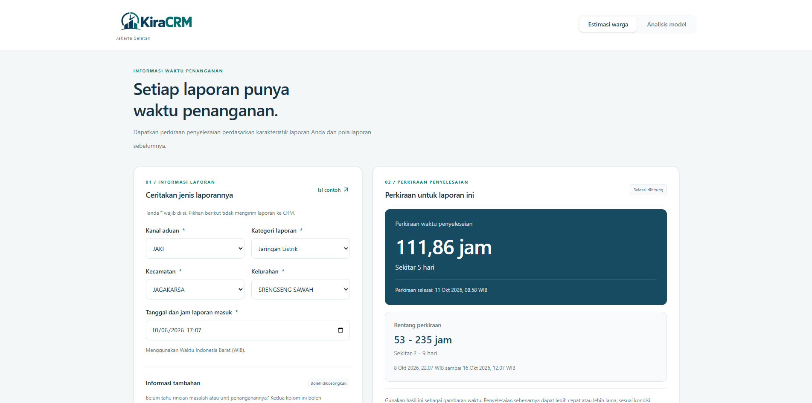

# KiraCRM

<p align="center">
  
</p>

> Aplikasi web untuk memperkirakan waktu penyelesaian pengaduan Cepat Respon Masyarakat (CRM) di Jakarta Selatan.

[Buka KiraCRM](https://kiracrm.online) · [Jalankan di komputer sendiri](#menjalankan-aplikasi)

---

## 📖 Tentang KiraCRM

KiraCRM dibuat sebagai bagian dari penelitian skripsi. Pengguna mengisi informasi seperti kategori, lokasi, dan waktu masuk laporan. Aplikasi menampilkan perkiraan dalam jam, rentang waktu penyelesaian, dan pembanding dari laporan terdahulu. Perkiraan bisa dicoba lewat tombol **Isi contoh**.

## ✨ Fitur aplikasi

### Estimasi warga

- **Perkiraan waktu selesai.** CatBoost menghasilkan satu perkiraan dalam jam dan rentang di bawahnya.
- **Rincian dan unit opsional.** Jika salah satunya belum diketahui, aplikasi otomatis memakai model yang sesuai dengan kolom yang terisi.
- **Pembanding.** Lihat ringkasan waktu penyelesaian laporan terdahulu serta acuan SK Sekda jika ada rincian yang cocok. Tautan PDF membuka halaman sumbernya.

### Analisis model

- **Bandingkan 3 algoritma.** Lihat estimasi CatBoost, Random Forest, dan XGBoost untuk isian yang sama, beserta hasil evaluasinya.
- **Lihat laporan yang paling mirip.** Aplikasi mencari 30 laporan yang paling sering jatuh di daun CatBoost yang sama dengan isian pengguna. Jika memilih data latih dan data uji sekaligus, aplikasi mengambil 30 laporan dari masing-masing sumber.
- **Telusuri hasilnya.** Histogram menunjukkan durasi aktual kelompok terpilih. Grafik prediksi vs. aktual bisa diperbesar, digeser, dan difilter menurut kelompok laporan.

Plotly dimuat saat grafik analisis diperlukan. Formulir warga bisa dipakai tanpa menunggu library grafik.

---

## 🛠 Cara kerja

1. Browser mengambil halaman dan `options.json`. Saat deploy, `build_frontend.py` membuat keduanya untuk CDN Vercel. Daftar pilihan dibuat dari data latih aplikasi.
2. Saat pengguna menekan tombol hitung, `POST /api/predict` mengirim isian ke Flask. Backend memilih salah satu dari 4 versi model CatBoost, mengubah isian ke format yang dikenali model, lalu menghitung perkiraan dan rentangnya.
3. `POST /api/context` mengambil laporan pembanding dan acuan SK Sekda. Pada halaman analisis, permintaan ini juga mengambil estimasi 3 model dan data grafik. Pemilih sumber latih atau uji memakai `POST /api/analysis`.

### Model dan hasil uji

Data dibagi acak 80/20 dengan seed 21. Batas atas IQR dihitung untuk tiap kategori dari data latih. Dari 16.372 laporan latih, 14.746 dipakai untuk melatih model akhir. Model mempelajari target `log(1 + durasi dalam jam)`, lalu hasilnya dikembalikan ke jam. Rentang dihitung dari simpangan baku error prediksi *out-of-fold* (OOF) pada 5-fold di data latih.

| Model | Data uji | MAE | RMSE | R² | Median error |
| --- | ---: | ---: | ---: | ---: | ---: |
| CatBoost dengan isian lengkap | 3.700 laporan lolos IQR | 61,74 jam | 183,43 jam | 0,3677 | 22,84 jam |

Skor di atas menggambarkan kinerja pada laporan uji yang durasi aktualnya berada dalam batas IQR. Laporan baru tetap bisa membutuhkan waktu lebih lama dari perkiraan.

## 🧰 Tech stack

- **Frontend** · HTML, Tailwind CSS, JavaScript, dan Plotly.
- **Analytics** · Vercel Web Analytics untuk jumlah pengunjung dan page view.
- **Backend** · Python 3.12 dan Flask. `server.py` menjalankan Waitress pada local. Di Vercel, `api/index.py` memuat aplikasi dari `app.py`.
- **Machine learning** · CatBoost, Random Forest (`scikit-learn`), dan XGBoost.

## Struktur proyek

```text
KiraCRM/
├── api/index.py        # Entry point API untuk Vercel
├── app.py              # Membuat aplikasi Flask untuk API
├── build_frontend.py   # Menyiapkan HTML, JSON, dan aset untuk CDN
├── form_options.py     # Membuat daftar pilihan dari data latih
├── server.py           # Endpoint Flask dan startup Waitress
├── engine.py           # Encoding, prediksi, dan rentang perkiraan
├── presentation.py     # Pembanding historis, SK Sekda, dan data grafik
├── templates/          # HTML halaman warga dan analisis
├── static/             # JavaScript, CSS, logo, dan Plotly
├── models/             # Model terlatih, encoder, dan data pendukung
├── data/               # Pemetaan rincian laporan ke SK Sekda
├── public/documents/   # PDF SK Sekda
└── tests/              # Tes aplikasi
```

---

<a id="menjalankan-aplikasi"></a>

## 🚀 Menjalankan aplikasi

Gunakan Python 3.12. Dari PowerShell, jalankan:

```powershell
git clone https://github.com/SiEncan/KiraCRM.git
cd KiraCRM
python -m venv .venv
.\.venv\Scripts\python.exe -m pip install -r requirements.txt
.\.venv\Scripts\python.exe server.py
```

Buka [localhost:8765](http://127.0.0.1:8765/). Model sudah disertakan di repositori dan dimuat saat server mulai berjalan.

Pada Vercel, `python3 build_frontend.py` berjalan otomatis saat build. Script ini menyiapkan HTML, `options.json`, dan aset di `public/`. Hasil build disajikan lewat CDN, sedangkan permintaan `/api/` diteruskan ke Flask melalui `api/index.py`. Saat dijalankan dengan Waitress, Flask melayani page dan address `/options.json` yang sama.

### Menjalankan tes

```powershell
.\.venv\Scripts\python.exe -m unittest discover -s tests -v
```
